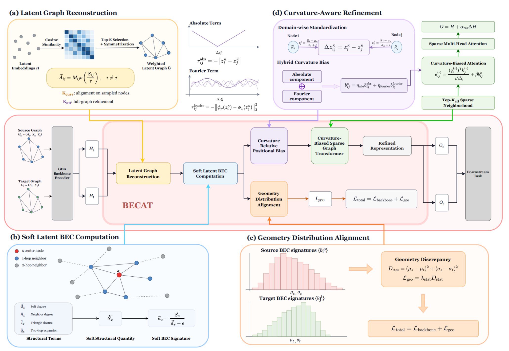

<div align="center">

# 🐱 BECAT: Bakry–Émery Curvature Alignment for Graph Domain Adaptation

BECAT is a plug-and-play, backbone-agnostic graph domain adaptation adapter. It uses latent geometric information to refine existing node representations while preserving the backbone's adaptation mechanism.

</div>

## Overview

Graph domain adaptation (GDA) transfers a node classifier from a labeled source graph to an unlabeled target graph. Existing methods address differences in node features and graph structure through adversarial, structural, spectral, and other objectives. Yet the local geometry induced by their learned representations may still differ across domains. BECAT adds a geometry-aware refinement step to an existing GDA backbone: it reconstructs sparse weighted latent graphs from the backbone embeddings, computes differentiable node-wise curvature signatures, aligns source and target curvature statistics, and uses curvature-aware sparse attention to refine the embeddings. The refined representations feed the downstream classifier; the backbone's original adaptation branch continues to use its original representations. BECAT is therefore complementary to the existing adaptation objective, rather than a replacement for it.

## Framework

<p align="center">
  
</p>

<p align="center"><strong>Figure 1. Overview of the BECAT framework.</strong></p>

1. **Latent graph reconstruction.** Build sparse weighted graphs from backbone-produced source and target node embeddings.
2. **Soft latent BEC computation.** Derive differentiable node-wise curvature signatures with a trace-based soft Bakry–Émery curvature proxy. This is **not** an exact Bakry–Émery curvature computation.
3. **Geometry distribution alignment.** Reduce source–target discrepancy by matching curvature-signature means and standard deviations.
4. **Curvature-aware refinement.** Apply hybrid curvature relative positional bias in sparse graph attention, then update node embeddings through a dimension-preserving residual connection.

The original backbone adaptation mechanism remains in place; BECAT adds a geometry loss and refines the classifier-facing representations.

## Key features

- **Plug-and-play across backbones:** integrations span adversarial, structural, spectral, reweighting, and propagation-based GDA methods.
- **Representation-induced geometry:** latent graphs are reconstructed from learned embeddings rather than assumed to match the input topology.
- **Two complementary geometry paths:** curvature-statistic alignment and curvature-aware sparse attention.
- **Residual refinement:** output embeddings retain the backbone representation dimension.

## Repository structure

```text
BECAT/
├── assets/                 # Figure 1 extracted from the paper
├── backbones/              # nine citation experiment integrations and run scripts
├── becat/
│   ├── torch/              # shared PyTorch adapter
│   └── tensorflow/         # TensorFlow 1.x adapter for AdaGCN
├── docs/                   # data, environment, and backbone provenance notes
└── README.md
```

## Supported backbones

All nine backbones evaluated on Citation in the paper have released integrations. Each directory contains its entry point, paired baseline/BECAT scripts, and backbone-specific instructions.

| Backbone | Released code and instructions | Framework |
|---|---|---|
| DANN | [DANN](backbones/DANN/README.md) | PyTorch |
| ASN | [ASN](backbones/ASN/README.md) | PyTorch |
| AdaGCN | [AdaGCN](backbones/AdaGCN/README.md) | TensorFlow 1.x |
| UDAGCN | [UDAGCN](backbones/UDAGCN/README.md) | PyTorch |
| GRADE | [GRADE](backbones/GRADE/README.md) | PyTorch |
| SpecReg | [SpecReg](backbones/SpecReg/README.md) | PyTorch |
| PairAlign | [PairAlign](backbones/PairAlign/README.md) | PyTorch |
| A2GNN | [A2GNN](backbones/A2GNN/README.md) | PyTorch |
| DGSDA | [DGSDA](backbones/DGSDA/README.md) | PyTorch |

## Installation

There is no single root environment: dependencies differ across backbones. Choose a backbone and follow its [environment instructions](docs/ENVIRONMENTS.md) and README. For the DANN example below, the repository documents:

```bash
conda create -n becat-dann "python>=3.7" pip
conda activate becat-dann
python -m pip install -r backbones/DANN/requirements.txt
```

These are the recorded installation instructions, not a claim of validation on every platform or device. AdaGCN uses a separate TensorFlow 1.x environment; the other integrations use PyTorch.

## Data preparation

Datasets are **not distributed** with this repository. The released citation experiments use ACMv9, Citationv1, and DBLPv7. Six backbones expect a raw-text `Citation/` tree; ASN, DANN, and AdaGCN expect a `Citation_mat/` tree with three MATLAB files. See [data layouts and provenance](docs/DATA.md) before running a backbone, then pass the relevant external data root through its documented interface.

## Quick start

From the repository root, after installing the DANN environment and supplying the external `Citation_mat/` data, run one ACMv9 → Citationv1 transfer. These commands use the existing [DANN entry point](backbones/DANN/main.py) and its documented settings:

```bash
DATA_ROOT=/absolute/path/to/Citation_mat

python -m backbones.DANN.main \
  --data_root "$DATA_ROOT" --source acmv9 --target citationv1 \
  --seed 1 --split_seed 42 --device cuda:0 \
  --epochs 1000 --lr 0.001 --weight_decay 0.0005 \
  --hidden_dim 128 --dropout 0.5 --lambda_domain 1.0

python -m backbones.DANN.main \
  --data_root "$DATA_ROOT" --source acmv9 --target citationv1 \
  --seed 1 --split_seed 42 --device cuda:0 \
  --epochs 1000 --lr 0.001 --weight_decay 0.0005 \
  --hidden_dim 128 --dropout 0.5 --lambda_domain 1.0 \
  --use_becat --lambda_becat 0.001
```

The commands require a working CUDA device as written. For the full six-transfer, five-seed citation sweep, use each backbone's [`run_baseline.sh`](backbones/DANN/scripts/run_baseline.sh) and [`run_becat.sh`](backbones/DANN/scripts/run_becat.sh) as documented in its README.

## Reproducing experiments

 **This code release documents the six directed Citation transfers** among ACMv9, Citationv1, and DBLPv7 for the nine backbones above.

For the released Citation protocol, source nodes are split 80%/10%/10% for training/validation/test with split seed 42. The scripts use backbone-specific training seeds and settings; checkpoints are selected by source validation accuracy, and target labels are loaded for final evaluation. See the [backbone READMEs](backbones/) for commands, [environment matrix](docs/ENVIRONMENTS.md), and [data guide](docs/DATA.md). Environment compatibility and exact cross-platform reproduction have not been established for every backbone.

## Results at a glance

The paper reports higher **average target Micro-F1 and Macro-F1** for all nine backbone pairs on the six Citation transfers. The largest reported average gain is for SpecReg: **+8.18 / +10.28 percentage points** in Micro-F1 / Macro-F1. The paper also evaluates DGSDA with BECAT on Blog, Airport, and Twitch and reports improvements on both metrics for every evaluated transfer task in those benchmarks. These are findings reported in the paper, not results generated by this repository checkout; the additional-benchmark runs are not documented in this release.

## Citation
**Coming Soon**

## Attribution and licenses

BECAT does not claim authorship of the integrated third-party backbones. See the [backbone provenance and license audit](docs/BACKBONES.md) for source repositories, preserved notices, and items requiring author review before release.
